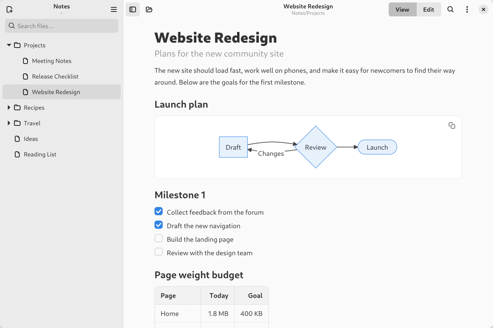
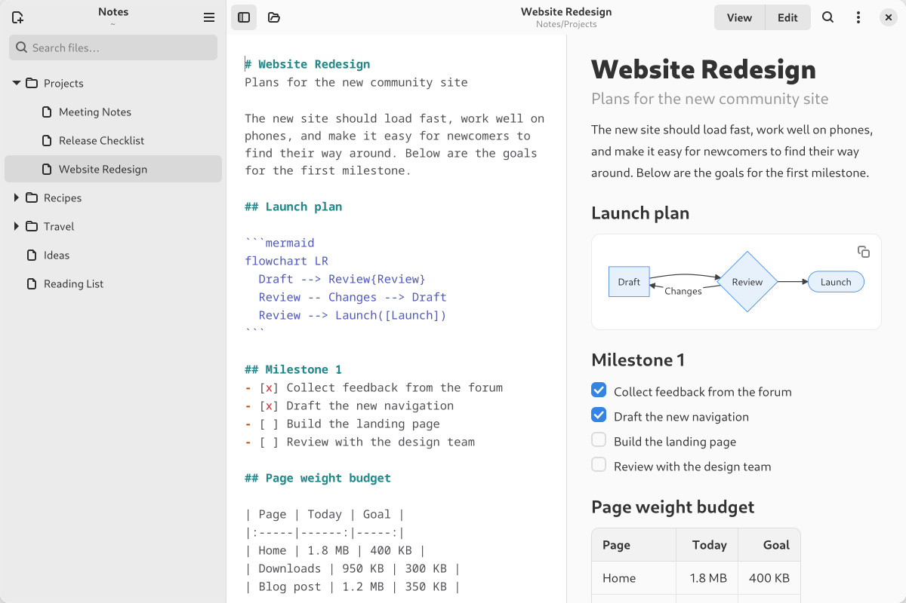
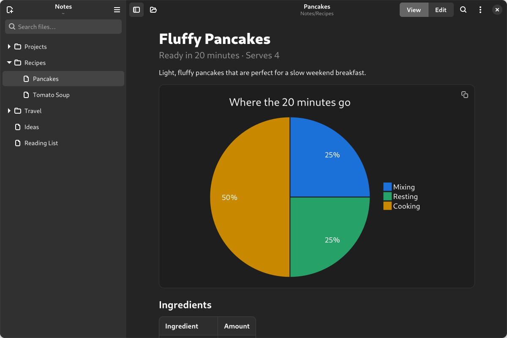

# Markdown Viewer

A native Markdown reader and editor for GNOME, written in Vala with GTK 4 and
libadwaita. Open a folder to browse its Markdown files in the sidebar, then read or
edit them. Markdown is parsed and rendered by the app itself into native widgets:
no web engine and no HTML library.



<table>
  <tr>
    <td></td>
    <td></td>
  </tr>
  <tr>
    <td align="center">Edit and preview side by side</td>
    <td align="center">Follows the system dark style</td>
  </tr>
</table>

## Install

Download `markdown-viewer.flatpak` from the
[latest release](https://github.com/jefersondaniel/markdown-viewer/releases/latest) and open it
with GNOME Software, or run:

```sh
flatpak install --user markdown-viewer.flatpak
```

This needs the [Flathub](https://flathub.org/setup) remote, which provides the GNOME runtime.

## Build and run

```sh
meson setup build
ninja -C build
./build/src/gnome-markdown              # reopens the last folder
./build/src/gnome-markdown ~/notes      # opens a folder
./build/src/gnome-markdown file.md      # opens a single file
```

To add it to your app grid (installs to `~/.local`):

```sh
meson setup build --prefix=$HOME/.local --reconfigure
ninja -C build install
```

## How it works

- **Sidebar:** the open folder as a tree of subfolders and Markdown files (`.md`,
  `.markdown`). Hidden files are left out. It updates by itself when files change on disk.
- **Search:** the field at the top of the sidebar finds files by name or content.
- **Right-click:** a file or folder offers Rename, Show in Files and Move to Trash.
  On folders it also offers New Note and New Folder.
- **Trash:** files go to the system trash, with Undo.
- **Saving:** automatic, shortly after you stop typing, and when you switch files or
  close the window.
- **New notes:** they start as drafts that exist only in the app. Ctrl+S, or Save… in
  the note menu, asks for a name and a folder (the first line is suggested). Leaving a
  draft that has text asks whether to save or discard it, and Discard in the note menu
  drops it, with Undo.
- **Selecting text:** in View mode a selection can run across paragraphs, lists, code
  and tables, scrolling when you drag past the edge. Double-click selects a word,
  triple-click a paragraph and Ctrl+A the whole note. Ctrl+C or the right-click menu
  copies it as plain text.
- **Text size:** Ctrl+Plus and Ctrl+Minus (or Ctrl and the scroll wheel) zoom the note from 80% to
  200%, and Ctrl+0 resets it. The note menu has the same controls.
- **State:** the last folder, the last file, the text size and the window state are kept in
  `~/.config/io.github.jefersondaniel.MarkdownViewer/state.ini`.

## Markdown support

CommonMark plus the GitHub extensions:

- Headings, emphasis, links (including reference links), images, block quotes, lists and code
- Tables with alignment, task lists (clickable in View mode), strikethrough, bare URLs
- [Mermaid](https://mermaid.js.org/) diagrams in `mermaid` code blocks: flowcharts, sequence,
  class, state and entity relationship diagrams, and pie charts. They're drawn natively by
  [mermaid-gtk](subprojects/mermaid-gtk/), and its [feature list](subprojects/mermaid-gtk/FEATURES.md)
  shows which parts of the syntax are supported. Other diagram types, and diagrams with
  errors, are shown as code with a short explanation.

A paragraph written directly under the first `#` title, with no blank line in
between, is shown as a subtitle. The **Markdown Guide** in the main menu shows
everything in action.

### Supported HTML

These inline tags are supported:

- `<b>`, `<strong>`, `<i>`, `<em>`, `<u>`, `<ins>`, `<s>`, `<del>`
- `<code>`, `<kbd>`, `<mark>`, `<sub>`, `<sup>`, `<small>`
- `<a href>`, `<br>`, ``

These block tags are supported:

- `<p>`, `<div>` and `<center>`, including `align="center|right"`
- `<h1>` to `<h6>`
- `<details>` with `<summary>`
- `<hr>`

HTML comments are hidden. Any other tag is dropped, but the text inside it is kept.

## Code layout

| Path | Purpose |
|:--|:--|
| `src/markdown/parser.vala` | Block parser (lists, quotes, tables, HTML blocks…) |
| `src/markdown/inline-parser.vala` | Emphasis, links, code spans, entities, inline HTML |
| `src/markdown/renderer.vala` | Document tree → GTK widgets |
| `src/window.blp`, `src/window.vala` | Main window (Blueprint layout + logic) |
| `src/widgets/file-tree.vala` | Sidebar folder tree and file search |
| `src/editor.vala` | Source editor with list continuation and shortcuts |
| `src/files.vala` | File name helpers |
| `src/app.css` | Styling of rendered Markdown |
| `subprojects/mermaid-gtk/` | Mermaid diagram library, kept separate from the app |

## Releasing

Releases are automatic. Commit messages follow
[Conventional Commits](https://www.conventionalcommits.org/) (see [AGENTS.md](AGENTS.md)), and
[release-please](https://github.com/googleapis/release-please) uses them on every push to
`main`:

1. It opens or updates a release pull request that bumps `version.txt` and adds the new
   entries to `CHANGELOG.md`. `feat` commits bump the minor version and `fix` commits the
   patch version.
2. Merging that pull request tags the commit (for example `v0.2.0`) and publishes a GitHub
   release with the changelog.
3. The [release workflow](.github/workflows/release.yml) then builds the Flatpak and attaches
   `markdown-viewer.flatpak` to the release.

The [Flatpak workflow](.github/workflows/flatpak.yml) also builds the app for pushes and pull
requests that change the app or its packaging, to catch build problems early. Changes to
documentation or screenshots don't trigger it. The Flatpak manifest is in `build-aux/flatpak/`.

## License

Markdown Viewer is free software under the [GNU General Public License](COPYING), version 3
or later. The Mermaid library in `subprojects/mermaid-gtk/` includes code ported from
Mermaid and dagre, which are under the MIT License; see its [README](subprojects/mermaid-gtk/README.md).
